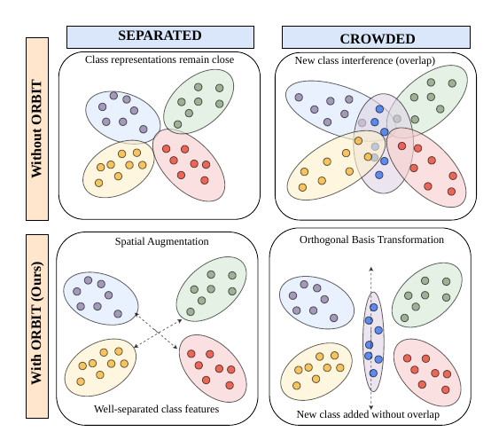
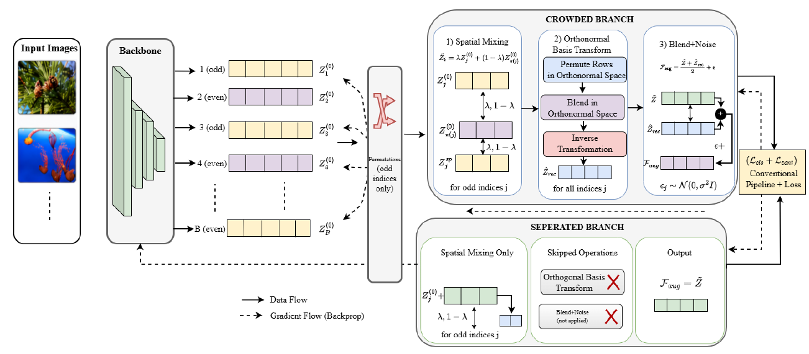

<div align="center">

# 🪐 ORBIT
### Crowding-Aware Geometric Routing
#### for Few-Shot Class-Incremental Learning

-1f6feb?style=flat-square)


**⭐ +5.19% on miniImageNet · +5.21% on CIFAR-100 ⭐**
*average incremental accuracy over the previous best (FACL, WACV 2025)*

▸ [**About**](#-about) · [**Method**](#-method) · [**Results**](#-results) · [**Ablations**](#-ablations) · [**Installation**](#-installation) · [**Datasets**](#-datasets) · [**Training**](#-training) · [**Analysis Scripts**](#-analysis-scripts) · [**Citation**](#-citation) ◂

</div>

---

## 📖 About

This repository contains the official PyTorch implementation of our WACV 2027 (Applications Track) submission:

> **ORBIT: Crowding-Aware Geometric Routing for Few-Shot Class-Incremental Learning**
> *ORthonormal Basis Incremental Representation Tuning*
> WACV 2027 Submission #107

📄 **Paper:** Accepted in WACV 2027.

Few-shot class-incremental learning (FSCIL) freezes the backbone after base training and relies entirely on that representation for every future session. ORBIT measures how the base-class feature space is actually organized — before any gradient step is taken — and routes augmentation accordingly, rather than applying one fixed policy to every dataset.

> [!TIP]
> **TL;DR** — Before training, ORBIT runs one forward pass, measures how *crowded* the base-class feature space is, and routes augmentation accordingly: crowded spaces get blending + a random orthonormal transformation; well-separated spaces get blending only. **No extra parameters. No stored exemplars. No manual tuning.**

<p align="center">
  
</p>
<p align="center"><sub>Without ORBIT, a new class overlaps existing prototypes in a <b>CROWDED</b> base space. ORBIT prevents this in both regimes — spatial augmentation alone under <b>SEPARATED</b>, and an orthonormal transformation under <b>CROWDED</b>.</sub></p>

## 📝 Abstract

<details>
<summary><b>Click to expand / collapse</b></summary>
<br>

Few-shot class-incremental learning (FSCIL) requires a model to absorb new categories from very few examples without forgetting old ones. Most methods freeze the backbone after base training and rely entirely on that representation for all future sessions, but nothing in standard base training prepares the embedding geometry for this role.

We introduce **OR**thonormal **B**asis **I**ncremental Representation **T**uning (**ORBIT**), which measures how base-class features occupy the embedding space before training begins, and routes augmentation accordingly. The routing statistic is the participation ratio of the feature covariance — a scale-invariant measure of how many effective directions the base-class features actually spread across. In **crowded** feature spaces, paired embeddings are blended and passed through a random orthonormal transformation that redistributes variance across all channels. In **separated** feature spaces, the transformation is skipped to preserve the structure that already distinguishes nearby classes. ORBIT adds no parameters, stores no exemplars, and costs one extra forward pass.

</details>

---

## 🧠 Method

### Geometry-Driven Routing

ORBIT follows one simple principle:

> 🪐 **Measure the geometry first, then decide how hard to augment.**

Before any gradient step, ORBIT runs a single forward pass over the base session and scores effective dimensionality via the **participation ratio** of the feature covariance:

$$
\rho = \frac{\left(\sum_{j=1}^{d}\lambda_j\right)^2}{\sum_{j=1}^{d}\lambda_j^2},
\qquad
\text{regime} =
\begin{cases}
\text{Crowded}, & \rho \ge \tau \\
\text{Separated}, & \rho < \tau
\end{cases}
$$

where $\lambda_1, \dots, \lambda_d$ are the eigenvalues of the base-class feature covariance. $\rho$ ranges from **1** (all variance in one direction) to **d** (variance spread evenly), and is computed directly from second-order statistics — no resampling, no labels beyond what base training already uses.

| 🔍 Feature Geometry | 📊 Measured ρ | ⚙️ ORBIT Regime |
| :--- | :---: | :--- |
| Variance spread thin — few examples capture only a slice of each class | high (≥ τ) | 🟣 **CROWDED** — blending + orthonormal transform + permutation mixing + noise |
| Variance concentrated — discriminative signal already compressed into a subspace | low (< τ) | 🟢 **SEPARATED** — paired blending (spatial augmentation) only |

**Choosing τ.** On the seven datasets evaluated, every SEPARATED ρ falls below every CROWDED ρ (22.7–42.5 vs. 50.8–96.6). **τ = 46.6** is the midpoint of this gap, and the same threshold is used for every dataset.

### 🏗️ Architecture

<p align="center">
  
</p>

**CROWDED branch** (per mini-batch of embeddings $Z$):

1. **Spatial mixing** — odd-indexed embeddings are blended with a random odd-indexed partner via convex combination (adapted from FACL): $\tilde Z_i = \lambda Z_i + (1-\lambda) Z_j$, with $\lambda = 0.5$.
2. **Orthonormal transform** — project with a fixed random orthonormal matrix $T$ ($TT^\top = I$, from the SVD of a Gaussian matrix): $\hat Z = \tilde Z T$. This decorrelates channels without changing vector norms.
3. **Permutation mixing** — blend with a row-shuffled copy: $\hat Z_{mix} = (\hat Z + \hat Z_{perm}) / 2$.
4. **Inverse transform** — reconstruct back into the original basis: $\hat Z_{rec} = \hat Z_{mix} T^\top$.
5. **Blend + noise** — $F_{aug} = (\tilde Z + \hat Z_{rec}) / 2 + \epsilon$, with isotropic Gaussian noise $\epsilon \sim \mathcal N(0, \sigma^2 I)$.

**SEPARATED branch:** only step 1 is applied; steps 2–5 are skipped and $\tilde Z$ is used directly.

Both branches train with proxy labels $y_p = y \cdot P + p$ ($P = 2$) and the joint objective $\mathcal L = \mathcal L_{cls} + \mathcal L_{cont}$. After base training the backbone is frozen, and incremental classes are handled by nearest-prototype cosine classification.

### 💡 Key Idea

- 🎯 **Blending** keeps synthetic samples geometrically grounded inside each class neighbourhood
- 🔄 **The orthonormal transformation** redistributes variance across all channels and adds variation that convex blending alone cannot produce
- 🧭 **The geometry check** ensures the aggressive branch fires only where it helps
- 🪶 **Zero overhead** — no extra parameters, no exemplar memory, one extra forward pass

---

## 📊 Results

### 🧭 Routing outcome per dataset (τ = 46.6)

| Dataset | ρ | Regime |
| :--- | :---: | :---: |
| GTSRB | 22.67 | 🟢 SEPARATED |
| STL10 | 42.26 | 🟢 SEPARATED |
| CUB-200 | 42.47 | 🟢 SEPARATED |
| CIFAR-100 | 50.82 | 🟣 CROWDED |
| DTD | 56.00 | 🟣 CROWDED |
| Food101 | 63.38 | 🟣 CROWDED |
| miniImageNet | 96.59 | 🟣 CROWDED |

> ORBIT numbers below are mean <sub>± std</sub> over multiple seeds.

### miniImageNet

<details open>
<summary><b>📋 Full session-by-session comparison (click to collapse)</b></summary>
<br>

| Method | 0 | 1 | 2 | 3 | 4 | 5 | 6 | 7 | 8 | Avg. Acc. | ΔFI | PD |
| :--- | :-: | :-: | :-: | :-: | :-: | :-: | :-: | :-: | :-: | :-: | :-: | :-: |
| Finetune | 61.31 | 27.22 | 16.37 | 6.08 | 2.54 | 1.56 | 1.93 | 2.60 | 1.40 | 13.45 | — | 59.91 |
| iCaRL | 61.31 | 46.32 | 42.94 | 37.63 | 30.49 | 24.00 | 20.89 | 18.80 | 17.21 | 33.29 | +15.81 | 44.10 |
| EEIL | 61.31 | 46.58 | 44.00 | 37.29 | 33.14 | 27.12 | 24.10 | 21.57 | 19.58 | 34.97 | +18.18 | 41.73 |
| TOPIC | 61.31 | 50.09 | 45.17 | 41.16 | 37.48 | 35.52 | 32.19 | 29.46 | 24.42 | 39.64 | +23.02 | 36.89 |
| F2M | 67.28 | 63.80 | 60.38 | 57.06 | 54.08 | 51.39 | 48.82 | 46.58 | 44.65 | 54.89 | +43.25 | 22.63 |
| CEC | 72.00 | 66.83 | 62.97 | 59.43 | 56.70 | 53.73 | 51.19 | 49.24 | 47.63 | 57.75 | +46.23 | 24.37 |
| FACT | 72.56 | 69.63 | 66.38 | 62.77 | 60.60 | 57.33 | 54.34 | 52.16 | 50.49 | 60.70 | +49.09 | 22.07 |
| TEEN | 73.53 | 70.55 | 66.37 | 63.23 | 60.53 | 57.95 | 55.24 | 53.44 | 52.08 | 61.43 | +50.68 | 21.45 |
| SAGG | 78.77 | 74.75 | 71.20 | 68.12 | 65.16 | 62.10 | 59.22 | 57.28 | 56.19 | 65.89 | +54.79 | 22.58 |
| ALICE | 80.60 | 70.60 | 67.40 | 64.50 | 62.50 | 60.00 | 57.80 | 56.80 | 55.70 | 63.99 | +54.30 | 24.90 |
| SAVC | 81.12 | 76.14 | 72.43 | 68.92 | 66.48 | 62.95 | 59.92 | 58.39 | 57.11 | 67.05 | +55.71 | 24.01 |
| MICS | 84.40 | 79.48 | 75.09 | 71.40 | 68.89 | 66.16 | 63.57 | 61.79 | 60.74 | 70.17 | +59.34 | 23.66 |
| FACL | 86.68 | 81.49 | 76.65 | 72.65 | 69.71 | 66.02 | 63.08 | 61.17 | 59.48 | 70.77 | +58.08 | 27.20 |
| Flexi-FSCIL | 77.37 | 74.96 | 70.73 | 66.50 | 63.95 | 62.44 | 61.49 | 60.29 | 59.69 | 66.38 | +58.29 | 19.76 |
| **ORBIT (Ours)** | **92.261**<sub>±0.143</sub> | **87.118**<sub>±0.105</sub> | **82.090**<sub>±0.057</sub> | **78.085**<sub>±0.088</sub> | **75.387**<sub>±0.449</sub> | **71.353**<sub>±0.250</sub> | **67.863**<sub>±0.136</sub> | **65.432**<sub>±0.327</sub> | **64.047**<sub>±0.295</sub> | **75.96** | **+62.65** | 28.21 |

</details>

### CIFAR-100

<details open>
<summary><b>📋 Full session-by-session comparison (click to collapse)</b></summary>
<br>

| Method | 0 | 1 | 2 | 3 | 4 | 5 | 6 | 7 | 8 | Avg. Acc. | ΔFI | PD |
| :--- | :-: | :-: | :-: | :-: | :-: | :-: | :-: | :-: | :-: | :-: | :-: | :-: |
| Finetune | 64.10 | 39.61 | 15.37 | 9.80 | 6.67 | 3.80 | 3.70 | 3.14 | 2.65 | 16.54 | — | 61.45 |
| iCaRL | 64.10 | 53.28 | 41.69 | 34.13 | 27.93 | 25.06 | 20.41 | 15.48 | 13.73 | 32.87 | +11.08 | 50.37 |
| EEIL | 64.10 | 53.11 | 43.71 | 35.15 | 28.96 | 24.98 | 21.01 | 17.26 | 15.85 | 33.79 | +13.20 | 48.25 |
| TOPIC | 64.10 | 55.88 | 47.07 | 45.16 | 40.11 | 36.38 | 33.96 | 31.55 | 29.37 | 42.62 | +26.72 | 34.73 |
| CEC | 73.07 | 68.88 | 65.26 | 61.19 | 58.09 | 55.57 | 53.22 | 51.34 | 49.14 | 59.53 | +46.49 | 23.93 |
| FACT | 74.60 | 72.09 | 67.56 | 63.52 | 61.38 | 58.36 | 56.28 | 54.24 | 52.10 | 62.24 | +49.45 | 22.50 |
| TEEN | 74.92 | 72.65 | 68.74 | 65.01 | 62.01 | 59.29 | 57.90 | 54.76 | 52.64 | 63.21 | +49.99 | 22.28 |
| ILAR | 77.50 | 73.20 | 70.80 | 66.70 | 64.00 | 62.10 | 60.50 | 58.70 | 56.40 | 65.54 | +53.75 | 21.10 |
| ALICE | 79.00 | 70.50 | 67.10 | 63.40 | 61.20 | 59.20 | 58.10 | 56.30 | 54.10 | 63.21 | +51.45 | 24.90 |
| SAGG | 79.13 | 74.68 | 71.29 | 66.98 | 64.39 | 61.35 | 59.57 | 57.93 | 55.33 | 65.63 | +52.68 | 23.80 |
| FACL | 86.20 | 81.55 | 76.95 | 72.50 | 68.75 | 65.68 | 63.16 | 60.62 | 58.20 | 70.40 | +55.55 | 28.00 |
| Flexi-FSCIL | 79.54 | 76.35 | 73.89 | 70.07 | 68.51 | 66.43 | 63.17 | 61.33 | 59.78 | 68.79 | +57.13 | 19.76 |
| **ORBIT (Ours)** | **92.156**<sub>±0.034</sub> | **86.975**<sub>±0.487</sub> | **82.233**<sub>±0.212</sub> | **77.524**<sub>±0.158</sub> | **73.971**<sub>±0.280</sub> | **70.839**<sub>±0.423</sub> | **68.359**<sub>±0.658</sub> | **65.814**<sub>±0.497</sub> | **62.653**<sub>±0.304</sub> | **75.61** | **+60.00** | 29.50 |

</details>

### CUB-200 *(fine-grained — routed to SEPARATED, spatial-only augmentation)*

<details>
<summary><b>📋 Full session-by-session comparison (click to expand)</b></summary>
<br>

| Method | 0 | 1 | 2 | 3 | 4 | 5 | 6 | 7 | 8 | 9 | 10 | Avg. Acc. | PD |
| :--- | :-: | :-: | :-: | :-: | :-: | :-: | :-: | :-: | :-: | :-: | :-: | :-: | :-: |
| Finetune | 68.68 | 43.70 | 25.05 | 17.72 | 18.08 | 16.95 | 15.10 | 10.06 | 8.93 | 8.93 | 8.47 | 21.97 | 60.21 |
| TOPIC | 68.68 | 62.49 | 54.81 | 49.99 | 45.25 | 41.40 | 38.35 | 35.36 | 32.22 | 28.31 | 26.28 | 43.92 | 42.40 |
| F2M | 81.07 | 78.16 | 75.57 | 72.89 | 70.16 | 68.17 | 67.01 | 65.26 | 63.36 | 61.76 | 60.26 | 69.42 | 20.81 |
| CEC | 75.85 | 71.94 | 68.50 | 63.50 | 62.43 | 58.27 | 57.73 | 55.81 | 54.83 | 53.52 | 52.28 | 61.33 | 23.57 |
| TEEN | 77.26 | 76.13 | 72.81 | 68.16 | 67.77 | 64.40 | 63.25 | 62.29 | 61.19 | 60.32 | 59.31 | 66.63 | 17.95 |
| ALICE | 77.40 | 72.70 | 70.60 | 67.20 | 65.90 | 63.40 | 62.90 | 61.90 | 60.50 | 60.60 | 60.10 | 65.75 | 17.30 |
| MICS | 78.77 | 75.37 | 72.30 | 68.72 | 67.45 | 65.40 | 64.72 | 63.39 | 61.89 | 61.89 | 61.37 | 67.39 | 17.40 |
| SAGG | 81.19 | 78.12 | 75.11 | 70.62 | 70.48 | 67.18 | 66.27 | 64.72 | 63.91 | 63.42 | 62.46 | 69.41 | 18.73 |
| FACL | **82.74** | **80.09** | **76.89** | 71.31 | **70.51** | **68.12** | **67.54** | **66.97** | **66.05** | **65.39** | **64.70** | **70.94** | 18.04 |
| **ORBIT (Ours)** | 82.265<sub>±0.296</sub> | 79.414<sub>±0.671</sub> | 75.584<sub>±0.514</sub> | **71.460**<sub>±0.571</sub> | 70.131<sub>±0.522</sub> | 67.928<sub>±0.721</sub> | 67.344<sub>±0.240</sub> | 66.508<sub>±0.256</sub> | 65.036<sub>±0.093</sub> | 64.521<sub>±0.251</sub> | 63.683<sub>±0.199</sub> | 70.35 | 18.58 |

</details>

> [!NOTE]
> ORBIT correctly routes CUB-200 to the SEPARATED regime and trails FACL by under 0.6 points — a much smaller cost than initially hypothesized for withholding the stronger augmentation branch on an already well-separated feature space. Forcing CROWDED on CUB-200 drops average accuracy to 69.46%, whereas forcing SEPARATED on miniImageNet costs 5.35 points (75.96% → 70.61%).

### 🌐 Additional benchmarks

Each dataset is evaluated under the regime selected automatically at τ = 46.6.

| Dataset | Regime | 0 | 1 | 2 | 3 | 4 | 5 | 6 | 7 | 8 | Avg. Acc. |
| :--- | :---: | :-: | :-: | :-: | :-: | :-: | :-: | :-: | :-: | :-: | :-: |
| 🧶 DTD | 🟣 CROWDED | 72.295 | 61.096 | 53.600 | 49.529 | 46.368 | — | — | — | — | **56.58** |
| 🍜 Food101 | 🟣 CROWDED | 90.569 | 85.994 | 82.275 | 78.126 | 73.803 | 70.605 | 67.842 | 64.667 | 61.901 | **75.09** |
| 🚦 GTSRB | 🟢 SEPARATED | 98.967 | 95.206 | 91.093 | 85.590 | 81.136 | — | — | — | — | **90.40** |
| 🛩️ STL10 | 🟢 SEPARATED | 80.271 | 12.500 | 10.000 | — | — | — | — | — | — | 34.26* |

<sub>*STL10's 10-class label set cannot support the multi-session incremental protocol regardless of augmentation strategy — a dataset/protocol mismatch, reported here for completeness rather than as evidence for or against routing.</sub>

### 🏆 Summary

| Dataset | Avg. Acc. | Gain over Previous Best (FACL) |
| :--- | :---: | :---: |
| 🖼️ **miniImageNet** | 75.96 |  |
| 🧩 **CIFAR-100** | 75.61 |  |
| 🐦 **CUB-200** | 70.35 |  |

---

## 🔬 Ablations

<details open>
<summary><b>🧪 Component-wise ablation — miniImageNet, seed 1 (click to collapse)</b></summary>
<br>

| Variant | Session 0 | Avg. Acc. | Final |
| :--- | :-: | :-: | :-: |
| T = I (no rotation) | 91.48 | 73.32 | 60.49 |
| w/o noise | 92.37 | 75.38 | 63.34 |
| w/o normalization | 92.13 | **76.02** | 63.73 |
| **ORBIT (full)** | **92.43** | 75.99 | **64.26** |

</details>

<details open>
<summary><b>🔀 vs. generic feature-mixing — miniImageNet (click to collapse)</b></summary>
<br>

| Method | Avg. Acc. |
| :--- | :-: |
| Manifold-MixUp | 55.74 |
| CutMix | 60.11 |
| MixUp | 65.89 |
| FACL | 70.77 |
| **ORBIT (Ours)** | **75.96** |

</details>

The ablation log for the w/o-noise variant is included at `models/ORBIT/without_noise.txt`.

---

## ⚡ Installation

**1. Clone the repository**

```bash
git clone <anonymous-repo-url>
cd ORBIT
```

**2. Install dependencies**

```bash
pip install -r requirements.txt
```

> [!TIP]
> We recommend using a dedicated Conda or virtual environment.

---

## 📦 Datasets

ORBIT is evaluated on three standard FSCIL benchmarks plus four additional datasets. The primary benchmarks follow the class splits and session protocol of [TOPIC](https://arxiv.org/abs/2004.10956) / CEC.

### 📌 Standard benchmarks

| Dataset | How to get it |
| :--- | :--- |
| 🧩 CIFAR-100 | Downloaded automatically by the training pipeline |
| 🐦 CUB-200 | Manual download — link below |
| 🖼️ miniImageNet | Manual download — link below |

### 🔗 Downloads

[](https://drive.google.com/file/d/1p2mQ4ruI3ux8ffyA00cR0Q-k2a8XaY0E/view?usp=sharing)
[](https://drive.google.com/file/d/1rTkDS_ERCcKV9Sr1qWPIbVUWBT9PHzz6/view?usp=sharing)

```bash
tar -xvf miniimagenet.tar
tar -xvzf CUB_200_2011.tgz
```

Session index lists are already provided under `dataset/<name>/index_list/`.

### 🌐 Additional benchmarks

| Dataset | Domain | Classes | Base | Incremental | Official source |
| :--- | :--- | :-: | :-: | :-: | :--- |
| 🧶 DTD | Textures | 47 | 27 | 4 × 5-way 5-shot | [robots.ox.ac.uk/~vgg/data/dtd](https://www.robots.ox.ac.uk/~vgg/data/dtd/) |
| 🍜 Food101 | Food | 101 | 61 | 8 × 5-way 5-shot | [data.vision.ee.ethz.ch/cvl/datasets_extra/food-101](https://data.vision.ee.ethz.ch/cvl/datasets_extra/food-101/) |
| 🚦 GTSRB | Traffic signs | 43 | 23 | 4 × 5-way 5-shot | [benchmark.ini.rub.de/gtsrb_dataset.html](https://benchmark.ini.rub.de/gtsrb_dataset.html) |
| 🛩️ STL10 | Low-resolution objects | 10 | 6 | 2 × 2-way 5-shot | [cs.stanford.edu/~acoates/stl10](https://cs.stanford.edu/~acoates/stl10/) |

The FSCIL session splits used in the paper are already included in `dataset/<name>/index_list/`. To regenerate them, run the corresponding script:

```bash
python dataloader/dtd/dtd/make_index_lists.py
python dataloader/food101/food101/make_index_lists.py
python dataloader/gtsrb/gtsrb/make_index_lists.py
python dataloader/stl10/stl10/make_index_lists.py
```

After setup, your `dataset/` directory should look like:

```
dataset/
├── cifar-100-python/
├── cub200/
├── mini_imagenet/
├── dtd/
├── food101/
├── gtsrb/
└── stl10/
```

---

## 🚀 Training

Training is launched via `train.py` for every dataset, switching only the `-dataset` flag and its hyperparameters. The routing regime (CROWDED / SEPARATED) is selected automatically before base training.

<details open>
<summary><b>🧩 CIFAR-100</b></summary>

```bash
python train.py \
  -project ORBIT \
  -dataset cifar100 \
  -lr_base 0.1 \
  -lr_new 0.001 \
  -epochs_base 600 \
  -schedule Cosine \
  -gpu 0 \
  -moco_dim 32 \
  -mlp \
  -moco_t 0.07 \
  -moco_m 0.995 \
  -size_crops 32 18 \
  -min_scale_crops 0.9 0.2 \
  -max_scale_crops 1.0 0.7 \
  -num_crops 2 4 \
  -constrained_cropping \
  -fantasy rotation2
```
</details>

<details>
<summary><b>🐦 CUB-200</b></summary>

```bash
python train.py \
  -project ORBIT \
  -dataset cub200 \
  -gamma 0.1 \
  -lr_base 0.002 \
  -lr_new 0.000005 \
  -epochs_base 120 \
  -schedule Milestone \
  -milestones 60 80 100 \
  -gpu 0 \
  -moco_dim 128 \
  -mlp \
  -moco_t 0.07 \
  -moco_m 0.999 \
  -size_crops 224 96 \
  -min_scale_crops 0.2 0.05 \
  -max_scale_crops 1.0 0.14 \
  -num_crops 2 4 \
  -constrained_cropping \
  -fantasy rotation2
```
</details>

<details>
<summary><b>🖼️ miniImageNet</b></summary>

```bash
python train.py \
  -project ORBIT \
  -dataset mini_imagenet \
  -gamma 0.1 \
  -lr_base 0.1 \
  -lr_new 0.1 \
  -epochs_base 120 \
  -schedule Milestone \
  -milestones 40 70 100 \
  -gpu 0 \
  -moco_dim 128 \
  -mlp \
  -moco_t 0.07 \
  -moco_m 0.999 \
  -size_crops 84 50 \
  -min_scale_crops 0.2 0.05 \
  -max_scale_crops 1.0 0.14 \
  -num_crops 2 4 \
  -constrained_cropping \
  -fantasy rotation2
```
</details>

<details>
<summary><b>🌐 DTD · Food101 · GTSRB · STL10</b></summary>

The additional benchmarks use the same entry point and the miniImageNet-style hyperparameters; set `-dataset` to `dtd`, `food101`, `gtsrb` or `stl10`:

```bash
python train.py \
  -project ORBIT \
  -dataset food101 \
  -gamma 0.1 \
  -lr_base 0.1 \
  -lr_new 0.1 \
  -epochs_base 120 \
  -schedule Milestone \
  -milestones 40 70 100 \
  -gpu 0 \
  -moco_dim 128 \
  -mlp \
  -moco_t 0.07 \
  -moco_m 0.999 \
  -size_crops 84 50 \
  -min_scale_crops 0.2 0.05 \
  -max_scale_crops 1.0 0.14 \
  -num_crops 2 4 \
  -constrained_cropping \
  -fantasy rotation2
```
</details>

---

## 🔬 Analysis Scripts

Scripts used for the geometry analysis and ablations in the paper live in `models/ORBIT/`:

| Script | Purpose |
| :--- | :--- |
| `check_granularity.py` | Computes the crowding score ρ (participation ratio) and the routing regime |
| `check_datasets_crowding.py` | Crowding analysis across datasets |
| `check_datasets_fine_grained.py` | Analysis for fine-grained datasets |
| `check_augmentation_downstream.py` | Downstream effect of each augmentation branch |

---

## 📁 Repository Structure

```
ORBIT/
├── 📂 augmentations/      Image-level augmentations
│   └── auto_augment/
├── 📂 dataloader/         Dataset loaders and index-list builders
│   ├── cifar100/
│   ├── cub200/
│   ├── dtd/
│   ├── food101/
│   ├── gtsrb/
│   ├── miniimagenet/
│   └── stl10/
├── 📂 dataset/            Datasets and FSCIL session index lists
│   ├── cifar-100-python/
│   ├── cub200/
│   ├── dtd/
│   ├── food101/
│   ├── gtsrb/
│   ├── mini_imagenet/
│   └── stl10/
├── 📂 models/             ORBIT pipeline and backbones
│   ├── ORBIT/
│   ├── resnet18_encoder.py
│   └── resnet20_cifar.py
├── 📄 LICENSE
├── 📄 losses.py           Loss functions
├── 📄 README.md
├── 📄 requirements.txt    Python dependencies
├── 📄 train.py            Training entry point
└── 📄 utils.py            Shared utilities
```

---

## ♻️ Reproducibility

All experiments use the same FSCIL protocol (TOPIC splits), the same training configuration across datasets, and frozen-backbone, nearest-prototype inference. The routing decision (CROWDED vs. SEPARATED) is computed once from base-session features using a single threshold τ = 46.6 shared across all datasets — it is not a learned or per-dataset-tuned parameter. Reported ORBIT numbers are mean ± std over multiple seeds.

---

## 📚 Citation

If you find ORBIT useful in your research, please consider citing our work and ⭐ starring this repository.

```bibtex
@inproceedings{orbit_2027,
  title     = {ORBIT: Crowding-Aware Geometric Routing for Few-Shot Class-Incremental Learning},
  author    = {Anonymous},
  booktitle = {IEEE/CVF Winter Conference on Applications of Computer Vision (WACV)},
  year      = {2027}
}
```

> [!NOTE]
> Author names and full citation details will be updated after the review process.

---

## 🙏 Acknowledgements

This project builds upon prior open-source work in few-shot class-incremental learning and feature augmentation, in particular **FACL** (Nema & Kurmi, WACV 2025) — from which ORBIT's paired blending is adapted — as well as [SAVC](https://github.com/zysong0113/SAVC) and [CEC](https://github.com/icoz69/CEC-CVPR2021). We thank the authors for making their implementations publicly available.

<div align="center">

### 🪐 Let's start ORBITing...*

</div>
